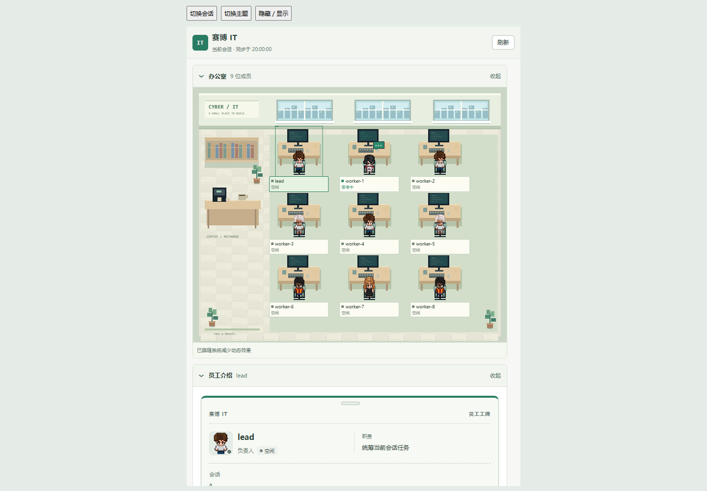
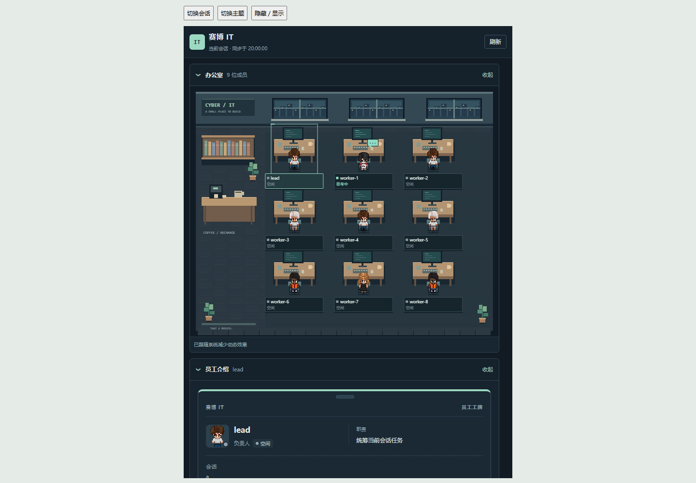

# 赛博 IT · DSH Cyber Department

把 DSH Agent Teams 显示成可交互的像素办公室，在当前会话右侧查看成员、任务和工作状态，并通过员工工牌沟通。

社区插件，非 DeepSeek 官方产品。源码以 [MIT](LICENSE) 开源；人物素材授权见 [THIRD_PARTY_NOTICES.md](THIRD_PARTY_NOTICES.md)。



<details>
<summary>查看深色模式</summary>



</details>

截图使用模拟团队。浅色 / 深色模式跟随 DSH 设置。

> 本地黑白界面整合版的变化和验证边界见 [实现说明](docs/MONOCHROME_IMPLEMENTATION.md)。下方截图为旧版历史截图。

## 手测后的界面调整

任务看板位于最上，办公室位于所有模块最下。“需要你处理”仅在已知事项需要核对时显示，普通成功回执不会使其常驻。头像改用原创清晰灰阶像素头像；桌面看板控件缩至约22px，触屏保留44px目标。

按用户要求，“消耗与预算”和“可复用员工档案”已移除。已有浏览器本地数据原样保留，不读取、不清空、不迁移。真实任务 Token 与费用统计尚未接入，不显示占位模块。

## 功能

- 当前会话右侧显示，不遮挡中间对话，不提供额外历史会话选择器。
- 加长桌面与隔板组成像素卡座，成员工牌贴在隔板上；人物动作表达思考、输出、工具执行、审批、阻塞、完成、空闲和离线。
- 办公室、员工介绍、任务看板、团队成员独立折叠；工位、任务与员工工牌联动。
- 任务筛选、搜索、完成进度、依赖显示和按需加载；按会话保留视图状态。
- 任务看板支持删除任务和通知成员立即执行；派活时可勾选“指派后立即执行”。不提供单个任务的估算百分比。
- 发消息、重开任务、派活和打断；进行中任务可标记完成。写入前需要确认。
- 本地预览先显示、后台验证快照；隐藏面板暂停同步，离屏或静止场景停止动画循环。

## 安装要求

- 已安装 DSH，插件声明兼容版本为 `>=0.2.1-rc.5 <0.3.0-0`。其他版本尚未验证。
- Node.js 24，或其他满足 `^22.19.0 || >=24.0.0` 的版本，以及 npm。
- Git 可选，也可以从 GitHub 的 **Code → Download ZIP** 下载后解压。
- 安装时需要联网下载 npm 依赖。插件运行时使用 DSH 的 React，不访问素材或脚本 CDN。

## 安装

### 1. 下载并构建

```sh
git clone https://github.com/Master-chai/dsh-cyber-dept.git
cd dsh-cyber-dept
npm ci
npm run build
npm test
```

ZIP 用户在解压后的插件目录打开终端，从 `npm ci` 开始。请保留这个文件夹：本地链接安装后，DSH 仍从这里加载插件。

### 2. 添加到正在使用的 DSH profile

如果终端可以运行 `dsh`，执行下列命令。将 `desktop` 改为实际配置名称，将路径改为插件的**绝对路径**：

```sh
dsh plugin --profile desktop add "link:D:/Plugins/dsh-cyber-dept"
```

macOS / Linux 使用自己的路径，例如 `link:/home/you/plugins/dsh-cyber-dept`。项目当前主要在 Windows 验证。

**Windows 桌面版没有 `dsh` 命令时**，在插件目录打开 PowerShell，通过应用内置 CLI 安装。修改第一行的 DSH 路径和第二行的 profile：

```powershell
$dshExe = 'D:\DSH\DeepSeek Harness.exe' # 改为实际可执行文件路径
$dshProfile = 'desktop'                 # 改为当前使用的 profile
$pluginPath = (Get-Location).Path.Replace('\', '/')
$dshCli = Join-Path (Split-Path $dshExe) 'resources\app.asar\dsh\node_modules\@deepseek-ai\dsh\lib\bin.js'
$previousElectronMode = $env:ELECTRON_RUN_AS_NODE
try {
    $env:ELECTRON_RUN_AS_NODE = '1'
    $arguments = @(('"' + $dshCli + '"'), 'plugin', '--profile', $dshProfile, 'add', ('"link:' + $pluginPath + '"'))
    $installer = Start-Process -FilePath $dshExe -ArgumentList $arguments -WindowStyle Hidden -Wait -PassThru
    if ($installer.ExitCode -ne 0) { throw "安装失败，退出码：$($installer.ExitCode)" }
} finally {
    $env:ELECTRON_RUN_AS_NODE = $previousElectronMode
}
```

此方式依赖当前 DSH 桌面包的 CLI 布局。如果应用升级后路径不存在，请使用新版 DSH 提供的插件安装入口或 CLI。

### 3. 打开插件

完整退出并重启 DSH，打开一个会话，点击侧栏 **IT**。插件在当前会话右侧显示；右侧栏新标签页也可选择“赛博 IT 部门”。没有团队或任务时显示空状态。

安装到其他 profile 时，当前窗口不会出现插件；启动的 DSH 必须与安装命令使用同一 profile。

## 使用、更新与卸载

选择成员 → 展开“员工介绍” → 在“沟通”区使用操作。[四个沟通功能的用法和失败恢复](docs/AGENT_ACTIONS.md)。

更新：退出 DSH，在仓库目录执行 `git pull --ff-only`、`npm ci`、`npm run build`、`npm test`，再启动 DSH。ZIP 用户先退出 DSH，再更新原安装目录并构建；目录改变时需要重新添加本地链接。

卸载：`dsh plugin --profile desktop remove dsh-cyber-dept`，然后重启 DSH。只有桌面内置 CLI 时，使用上方相同启动方式，将最后的 `add` 和 `link:...` 参数换成 `remove`、`dsh-cyber-dept`。

当前仅发布到 GitHub，未发布 npm。`package.json` 中 `private: true` 防止误发布 npm 包，不影响 GitHub 开源或本地链接安装。

## 开发与验证

修改 `src/client/` 后执行 `npm run build`，不要直接编辑生成文件 `client.js`。

```sh
npm run build        # 构建 DSH 客户端包
npm run build:check  # 确认产物与源码一致
npm run lint
npm run typecheck    # 核心状态和同步模块的渐进类型检查
npm test            # 必要检查及全部 Node 测试
```

v0.2.0 包含 249 项通过的自动测试，并以模拟宿主核验任务删除、立即执行、卡座工牌及浅深主题和宽窄窗口。自动测试不能替代真实 DSH 的写操作、完整动画观感或会话切换耗时验收。

源码结构和数据流见 [架构与开发](docs/ARCHITECTURE.md)。欢迎提交 Issue / Pull Request；复现时注明 DSH / Node 版本、操作步骤和日志，并隐藏 API 密钥及私人对话。

## 素材与致谢

参考 [Pixel Agents](https://github.com/pixel-agents-hq/pixel-agents) 的人物状态机、精灵和路径思路，以及 [Star Office UI](https://github.com/ringhyacinth/Star-Office-UI) 的状态可视化思路。人物精灵来自 Pixel Agents 的固定提交，原始作者为 JIK-A-4，保留授权与署名。未引入这些项目的服务，也未使用 Star Office UI 美术素材。详见 [第三方授权](THIRD_PARTY_NOTICES.md)。
