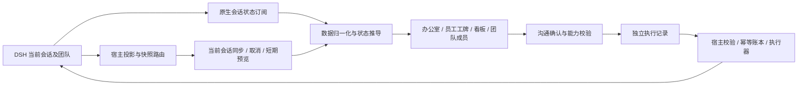

# 架构与开发

插件直接使用 DSH 的会话投影、团队任务和命令服务。只展示当前会话，不创建独立的任务数据库。



| 路径 | 职责 |
| --- | --- |
| `src/client/host/` | 右栏注册、导航生命周期 |
| `src/client/model/` | 输入归一化、合并和状态事实 |
| `src/client/sync/` | 当前会话选择、缓存预览、可取消快照同步 |
| `src/client/commands/` | 协议、执行记录和沟通 hook |
| `src/client/components/` | 页面、员工工牌、折叠、成员和弹窗 |
| `src/client/scene/` | 运动模型、路径、绘制、动画循环、精灵加载 |
| `src/client/task-board.js` | 过滤、搜索、任务选择与分页 |
| `src/client/office-theme.js` / `office-*.css` | DSH 浅深主题适配 |
| `src/host/` | 投影、历史读取缓存、快照与命令路由 |
| `src/shared/contract.js` | 宿主和客户端共用协议 |

## 构建

```sh
npm ci
npm run build
npm test
```

源码使用 JavaScript ESM。esbuild 输出 DSH 模块工厂，React 由宿主提供，CSS 和 PNG 内嵌，无运行时 CDN 请求。`client.js` 是需要提交的生成产物，只导出 `apply/inject`；测试入口生成 `.verify/client-test.js`，内部测试接口不进入生产包。

`npm test` 依次检查产物一致性、ESLint、渐进类型及 Node 测试。类型检查目前显式覆盖 `model/state.js` 和 `sync/snapshot-sync.js`，不是全项目 TypeScript 迁移。

## 状态与生命周期

- 快照验证前可显示当前会话的本地预览，预览不允许写操作。
- 会话切换取消旧订阅和请求，迟到响应不得覆盖新会话。
- 隐藏面板停止轮询；隐藏、离屏或无需动态的场景停止请求动画帧。
- 缓存有容量和有效期，页面筛选、折叠和选择按会话隔离。
- 导航回调绑定宿主生命周期，卸载/替换会取消定时器并失效旧回调。

## 写操作

写操作经过确认后才调用 DSH；任务变更携带任务 ID 与 revision。派活可创建并指派，也可直接指派已有任务。创建成功而指派失败时保留创建结果，避免重复创建。超时可能意味着结果未知，不自动重试；宿主幂等账本为进程内有限缓存，不是永久业务去重。

完整用法见 [员工沟通](AGENT_ACTIONS.md)。自动测试使用模拟服务，不能替代真实 DSH 的消息投递、任务执行和点击延迟验收。
